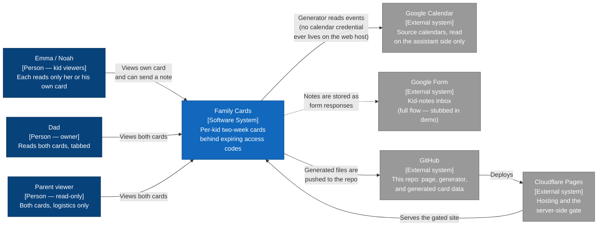
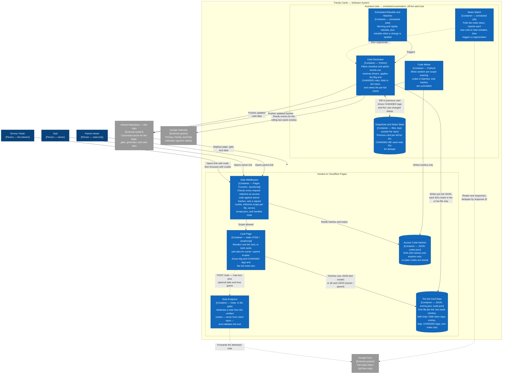

# Family Cards — Architecture

C4-lite diagrams for Family Cards, drawn from the **demo** system only:
invented kids (**Emma** / **Noah**), invented events, and generic external
services. No real family data, addresses, calendar identifiers, or secrets
appear here — or anywhere in this repo.

The page itself is deliberately simple for its readers: a rolling two-week
card, framed **With Dad / With Mom**, showing a kid's own events first,
highlighting non-school events as **Big**, showing a pickup or drop-off
only when Dad drives (the reader assumes Mom otherwise), and marking
exceptions with a single **CHANGED** tag.

This file is the canonical diagram source. It renders natively on GitHub,
and the same Mermaid source feeds the showcase site — there is no second,
hand-maintained copy.

## Level 1 — System Context (inset)

Who uses Family Cards, and which outside systems it touches.

## Level 2 — Container

The deployable and runnable pieces inside Family Cards, and how they
talk to each other. Solid arrows are live in the demo. The dashed notes
path is the designed full flow: in this demo repo the note box is shown
disabled and the `/note` endpoint is a stub that acknowledges and
discards, so no form is referenced here.

## The three flows

**1. Publishing a card (push, never pull).** The page never calls a
calendar API and no calendar credential lives on the web host. On the
assistant side, the generator reads the source calendars for the rolling
two-week window, drops sensitive and administrative events, frames each
day With Dad or With Mom, resolves pickup and drop-off drivers (an
explicit tag or transport name first, then driver proof from a matching
travel block, then the day-and-time rule), and keeps only the legs Dad
drives — plus any third-party leg, which is named and tagged CHANGED.
Entries whose time moved since the previous snapshot are tagged CHANGED
with the new time only. The generator writes one JSON file per kid and
pushes it; the host deploys it; the page just renders the latest file.

**2. Getting in (codes, not accounts).** Each link carries a one-time
access code. The gate hashes the code and matches it against
`codes.json`; on a match it sets a signed, scoped, expiring cookie
(HMAC-SHA256, keyed by a hosting secret) and redirects to the clean URL.
A kid scope can fetch only that kid's JSON; owner and parent scopes can
fetch both. An unknown or expired code fails closed. When the hosting
secret is not configured, the gate fails closed for everyone.

**3. Notes from a kid (designed full flow; stubbed in the demo).** A kid
writes in the note box on her or his own card — text plus an optional
date and optional estimated times, a guess being fine. The page posts to
the same-origin `/note` endpoint; the gate attributes the note from the
verified cookie, never from anything the client sends, and forwards it
to a Google Form that is never linked publicly. The notes watch polls
for new responses, reports each one to Dad verbatim, and triggers a
regeneration; the generator folds each kid's own notes into that kid's
JSON only, so the two cards stay isolated from each other. In this demo
the box is disabled and `/note` returns a stub acknowledgement and
discards the submission.

## Containers at a glance

| Container | Runs on | Responsibility |
|---|---|---|
| Card Page | Cloudflare Pages (static) | Render one card, or both with tabs; Big / CHANGED display; note box |
| Gate Middleware | Cloudflare Pages Function | Code redemption, signed scoped cookies, per-file scope enforcement, `/scope.json`, `/note` |
| Note Endpoint | In the gate (`/note`) | Attribute from the cookie, validate, forward (stub in demo) |
| Per-kid Card Data | Static JSON in this repo | The only thing the page renders; one file per kid |
| Access Code Hashes | Static JSON in this repo | Hashes and expiries for scoped codes; nothing plain |
| Card Generator | Assistant side (Python) | Calendars in, per-kid JSON out; all card rules live here |
| Code Minter | Assistant side (Python) | Mint expiring scoped codes; commit hashes only |
| Scheduled Rebuilds and Watches | Assistant side (scheduled jobs) | Morning / nightly / on-change regeneration triggers |
| Notes Watch | Assistant side (scheduled job) | New-note alerts to Dad, then regeneration (full flow only) |
| Snapshots and Notes State | Assistant side (files, outside the repo) | CHANGED diff baseline; note dedupe |

## Demo vs private

The demo and the private system run the same page, gate, minter, and
generator code. They differ only in data and in the notes endpoint:
the demo's card JSON is hand-written fake data for Emma and Noah, its
one public code is fixed and owner-scoped, and its notes flow stops at
the stub. Nothing about the private system's data, codes, calendars,
or form appears in this repo.
