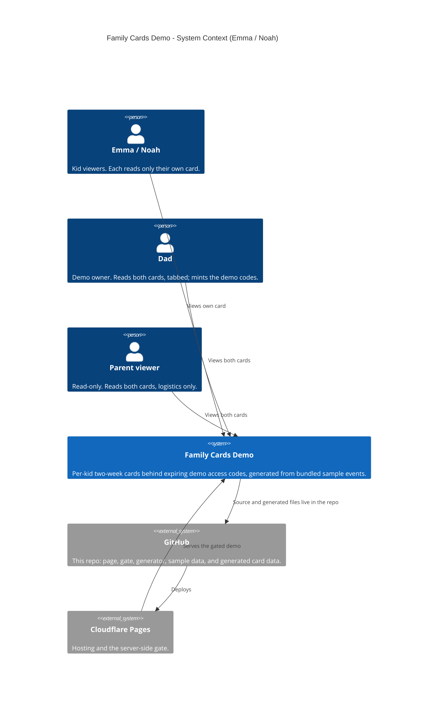
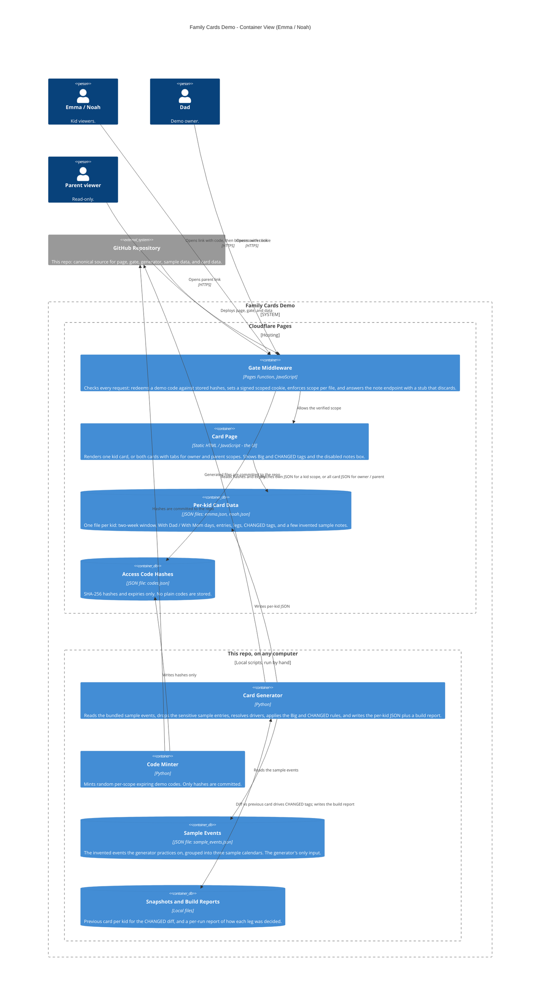
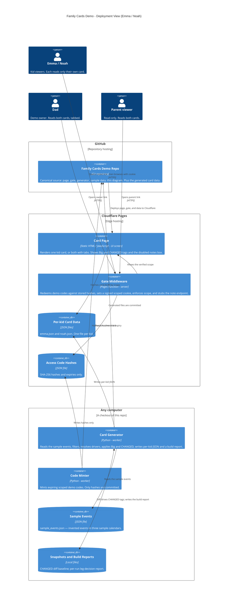

# Family Cards — Architecture (Demo)

C4-lite diagrams for the Family Cards **demo**, drawn from the demo
system only: invented kids (**Emma** / **Noah**), invented events, and
no external services at all. Everything in this repo is sample
content. The demo connects to no account, calendar, form, or other
service — its only input is a bundled file of invented events
(`sample_events.json`), and its note box is decorative: the endpoint
answers and discards, and nothing is collected anywhere.

The page itself is deliberately simple for its readers: a rolling
two-week card, framed **With Dad / With Mom**, showing a kid's own
events first, highlighting non-school events as **Big**, showing a
pickup or drop-off only when Dad drives (the reader assumes Mom
otherwise), and marking exceptions with a single **CHANGED** tag.

This file is the canonical diagram source. It renders natively on
GitHub, and the same source feeds the project site — there is no
second, hand-maintained copy.

**Canonical pattern (v3, adopted Oct 28, 2026):** three views —
System Context (L1), Container (L2), and a Deployment / host view —
with shapes keyed to the kind of thing (see the legend under the
Deployment view) and hosts drawn as their own deployment nodes. An
interactive, draggable rendering of the Deployment view lives beside
this file at
[docs/interactive-architecture.html](interactive-architecture.html):
dragging there explores the view and never changes this source.

## Level 1 — System Context (inset)

Who uses the demo, and where its pieces live.

## Level 2 — Container

Shapes are the native C4 shapes, so a type reads at a glance: a
**person figure** is a person, a **box** is a running container (the
UI page, a server function, a Python script), and a **cylinder** is
a data store. The generator and minter are plain Python scripts in
this repo that you run by hand — nothing is scheduled, and nothing
runs anywhere else.

## Deployment — Host view (v3)

Where each container actually runs: **GitHub** (repository hosting),
**Cloudflare Pages** (edge hosting), and **any computer** (the local
scripts and sample files, straight from a checkout of this repo).
People stand outside every host. There is no fourth host: no
external service is involved in the demo.

### Shape and host legend

| Visual | Means | Family Cards Demo examples |
|---|---|---|
| Person figure | A human user | Emma / Noah, Dad, Parent viewer |
| Browser window | A user screen / UI | Card Page |
| Server rack | A server / server-side function | Gate Middleware |
| Gear | A worker / local script | Card Generator, Code Minter |
| Cylinder | A database / data store | Per-kid Card Data, Access Code Hashes, Sample Events, Snapshots |
| Repository | A source / code store | GitHub repo |

## The three flows

**1. Building a card (local, from sample data).** The generator
reads the bundled sample events for the rolling two-week window,
drops the sample entries in sensitive categories, frames each day
With Dad or With Mom, resolves pickup and drop-off drivers (an
explicit tag or transport name first, then driver proof from a
matching travel block in the sample data, then the sample exception
lists, then the day-and-cutoff rule), and keeps only the legs Dad
drives — plus any third-party leg, which is named and tagged
CHANGED. Entries whose time moved since the previous snapshot are
tagged CHANGED with the new time only. The generator writes one
JSON file per kid; the files are committed; the host deploys them;
the page just renders the latest file.

**2. Getting in (demo codes, not accounts).** Each demo link
carries a one-time access code. The gate hashes the code and
matches it against `codes.json`; on a match it sets a signed,
scoped, expiring cookie (HMAC-SHA256, keyed by a hosting secret)
and redirects to the clean URL. A kid scope can fetch only that
kid's JSON; owner and parent scopes can fetch both. An unknown or
expired code fails closed. When the hosting secret is not
configured, the gate fails closed for everyone. On plain static
hosting (GitHub Pages) no gate runs at all, and the demo simply
opens both cards with tabs — which is why the demo banner shows
there.

**3. Notes (decorative in the demo).** The note box on each card
shows how a kid would send a note — text plus an optional date and
optional estimated times, a guess being fine. In this demo the box
is disabled and the `/note` endpoint returns a stub acknowledgement
and discards the submission. There is no inbox, no forwarding, and
no collection of anything; the only notes visible are the invented
ones baked into the sample card files.

## Containers at a glance

| Container | Shape in diagram | Runs on | Responsibility |
|---|---|---|---|
| Card Page | Browser window - UI screen | Cloudflare Pages (static) | Render one card, or both with tabs; Big / CHANGED display; disabled note box |
| Gate Middleware | Server rack - server function | Cloudflare Pages Function | Demo-code redemption, signed scoped cookies, per-file scope enforcement, `/scope.json`, `/note` stub |
| Per-kid Card Data | Cylinder - data store | Static JSON in this repo | The only thing the page renders; one file per kid |
| Access Code Hashes | Cylinder - data store | Static JSON in this repo | Hashes and expiries for scoped demo codes; nothing plain |
| Card Generator | Gear - worker | Any computer (Python) | Sample events in, per-kid JSON out; all card rules live here |
| Code Minter | Gear - worker | Any computer (Python) | Mint expiring scoped demo codes; commit hashes only |
| Sample Events | Cylinder - data store | This repo (JSON file) | The generator's only input; invented events in three sample calendars |
| Snapshots and Build Reports | Cylinder - data store | Local files | CHANGED diff baseline; per-run leg-decision report |

## What this demo is — and is not

Everything here is invented: the kids, the events, the places, the
codes. The demo runs entirely from this repo — sample file in,
static cards out — and connects to no calendar, account, form, or
other service. It exists to show the card design, the code-gate
pattern, and the generator's rule set on data anyone can inspect.
